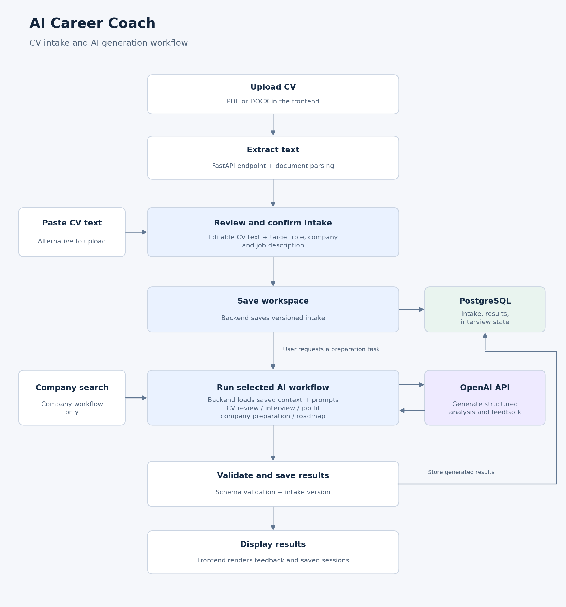

# AI Career Coach

AI Career Coach helps job seekers prepare for applications in one saved workspace, with CV feedback, mock interviews, job-fit analysis, company research, and personalized learning roadmaps.

## Project Overview

Preparing for a job application often means switching between tools and repeatedly entering the same information. AI Career Coach uses a shared candidate profile to support a connected preparation workflow.

### Main features

- **CV intake:** Upload a PDF or DOCX CV, inspect the extracted text, and add a target role, company, and job description.
- **CV review:** Generate strengths, gaps, and suggested improvements.
- **Mock interviews:** Practise generated questions and receive answer evaluation and feedback.
- **Job-fit analysis:** Compare the candidate profile against a job description and identify relevant strengths and gaps.
- **Company preparation:** Generate company research and interview preparation material.
- **Learning roadmap:** Turn identified gaps into learning priorities and next steps.
- **Saved workspaces:** Reopen past preparation sessions and identify outputs based on older intake details.

## Architecture

The frontend collects candidate details and displays coaching results. The backend handles document extraction, workspace persistence, and AI workflows.



### From CV upload to AI feedback

1. **Extract:** The frontend uploads a PDF or DOCX to `/api/cv/extract`. The backend extracts text and returns it to the intake form. Users can also paste CV text directly.
2. **Confirm:** The user reviews the text, adds the target role, company, and job description, and confirms the intake.
3. **Save:** The backend stores the confirmed intake as a versioned workspace in PostgreSQL.
4. **Generate:** When the user requests a preparation task, the backend loads the saved context and passes it to the relevant AI service with task-specific prompts. Company preparation also uses search tools.
5. **Validate and store:** The backend validates structured payloads with Pydantic and stores generated results with their intake version.
6. **Display:** The frontend displays the results and lets the user reopen the workspace later. Mock interviews also maintain questions, answers, and interview state across turns.

Document extraction prepares the CV text; AI services use that text through the confirmed workspace. The uploaded document does not need a direct connection to the OpenAI API.

### Tech stack

| Layer | Technology |
| --- | --- |
| Frontend | React, Vite, TypeScript |
| Backend | Python, FastAPI |
| Validation | Pydantic |
| Database | PostgreSQL, psycopg, JSONB |
| AI | OpenAI API, task-specific prompts |
| Document parsing | pypdf, python-docx |
| Company research | Search helpers and AI synthesis |

## Demo / Deployment

**[Try AI Career Coach](https://ai-career-coach-web.vercel.app/)**

The frontend is hosted on Vercel. The application uses a separate FastAPI backend and PostgreSQL for persistent storage.

### Try the application

1. Create a workspace using a fictional CV and job description.
2. Generate a CV review and inspect the recommendations.
3. Start a mock interview and submit answers.
4. Review job-fit analysis, company preparation, and the learning roadmap.
5. Reopen the workspace to continue preparation.

## How to Run the Project

### Prerequisites

- Git
- Python 3.11+ compatible with the backend dependencies
- Node.js and npm compatible with the project's Vite version
- A PostgreSQL database
- An OpenAI API key

### 1. Clone the repository

Replace `YOUR_REPOSITORY_URL` with the repository URL:

```bash
git clone YOUR_REPOSITORY_URL ai-career-coach
cd ai-career-coach
```

### 2. Configure the backend

Create `backend/.env` and populate the values locally:

```dotenv
DATABASE_URL=
OPENAI_API_KEY=
OPENAI_MODEL=
OPENAI_COMPANY_MODEL=
FRONTEND_URL=
```

- `DATABASE_URL`: PostgreSQL connection string.
- `OPENAI_API_KEY`: Key for AI requests.
- `OPENAI_MODEL`: Model used by the AI services.
- `OPENAI_COMPANY_MODEL`: Company-preparation model configuration.
- `FRONTEND_URL`: Allowed frontend origin, if read by the backend CORS configuration. For local development, use `http://localhost:5173`.

If company search requires separate credentials, configure those using the variable names expected by `search_tools.py`.

### 3. Start the backend

```bash
cd backend
python -m venv .venv
source .venv/bin/activate
python -m pip install -r requirements.txt
python -c "from src.database import create_tables; create_tables()"
uvicorn app:app --reload
```

On Windows PowerShell, use `.venv\Scripts\Activate.ps1` to activate the environment.

The database initialization step creates the required tables using the project’s schema.

- API: http://localhost:8000
- Interactive API documentation: http://localhost:8000/docs
- Alternative API documentation: http://localhost:8000/redoc

### 4. Configure and start the frontend

Create `frontend/.env`:

```dotenv
VITE_API_URL=http://localhost:8000
```

Open another terminal from the repository root:

```bash
cd frontend
npm install
npm run dev
```

Open http://localhost:5173. Ensure the backend permits this frontend origin through its CORS configuration.

### Validation

From `frontend/`:

```bash
npm run build
npm run lint
```

Run available backend tests against a separate test database. Build and lint checks validate the frontend code, while AI output quality requires separate evaluation.

## Project Structure

```text
.
├── backend/
│   ├── app.py                  # FastAPI routes and orchestration
│   ├── schema.sql              # Database schema
│   ├── requirements.txt        # Python dependencies
│   └── src/
│       ├── ai_company.py       # Company research and preparation
│       ├── ai_cv.py            # CV review and job-fit AI logic
│       ├── ai_interview.py     # Interview generation and feedback
│       ├── database.py         # PostgreSQL connection setup
│       ├── document_tools.py   # PDF/DOCX extraction
│       ├── interview_state.py  # Interview state and validation
│       ├── job_fit_service.py  # Job-fit workflow and persistence
│       ├── prompts.py          # Prompt templates
│       ├── repository.py       # Database CRUD operations
│       ├── roadmap_service.py  # Roadmap workflow and persistence
│       ├── schemas.py          # Pydantic request/response models
│       └── search_tools.py     # Company search helpers
├── frontend/
│   ├── src/
│   ├── package.json
│   └── vite.config.ts
├── sample_data/
├── README.md
└── .gitignore
```

### Backend API routes

| Method | Endpoint | Purpose |
| --- | --- | --- |
| GET | `/api/health` | Health check |
| POST | `/api/cv/extract` | Extract text from an uploaded CV |
| POST | `/api/workspaces` | Create a workspace |
| GET | `/api/workspaces/{workspace_id}` | Load a workspace |
| PUT | `/api/workspaces/{workspace_id}` | Update intake details |
| DELETE | `/api/workspaces/{workspace_id}` | Delete a workspace |
| POST | `/api/interviews` | Start a mock interview |
| GET | `/api/interviews/{interview_id}` | Load interview state |
| POST | `/api/interviews/{interview_id}/answers` | Submit an answer and continue the interview |
| POST / GET | `/api/workspaces/{workspace_id}/review` | Generate / load a CV review |
| POST / GET | `/api/workspaces/{workspace_id}/fit` | Generate / load job-fit analysis |
| POST / GET | `/api/workspaces/{workspace_id}/roadmap` | Generate / load a learning roadmap |
| POST / GET | `/api/workspaces/{workspace_id}/company-prep` | Generate / load company preparation |

See `/docs` on the running backend for request and response schemas.

## Limitations

- **AI reliability:** Feedback may contain unsupported claims or inconsistent suggestions. Users should review recommendations before applying them.
- **Job-fit scoring:** Scores are coaching estimates, not employer ATS scores or probabilities of being hired.
- **Document extraction:** Complex formatting or scanned PDFs may need manual correction; OCR support is not documented.
- **Company research:** Quality depends on source relevance, freshness, and the search integration.
- **Cost and latency:** AI workflows depend on external API availability, rate limits, and usage costs.
- **Session history:** Recent workspace identifiers are stored in browser local storage; clearing it can remove those shortcuts.

## Future Improvements

- **User accounts:** Add registration and login so users can access their preparation history across devices.
- **Personal preparation profiles:** Let users reuse their CV and preferences across multiple role-specific workspaces.
- **Preparation progress:** Track completed activities and learning goals for each application.
- **Document and research quality:** Improve CV extraction and company-source attribution.
- **Performance and reliability:** Track API cost and response time, and expand output-quality and security testing.

### Data and security

- Keep `.env` files, API keys, and database credentials out of Git.
- Never place secrets in frontend `VITE_` variables.
- Use fictional or anonymized CVs for demonstrations.
- CV context is sent to the configured AI provider, and workspace data and generated results are stored in PostgreSQL. Explain this data flow before collecting real CVs.

## Credits / References

Built as a collaborative AI engineering bootcamp project.

- **OpenAI API:** Pretrained LLM access for generation and analysis.
- **FastAPI and Pydantic:** Backend API and schema validation.
- **React, Vite, and TypeScript:** Frontend development.
- **PostgreSQL and psycopg:** Persistent storage and database access.
- **pypdf and python-docx:** CV text extraction.
Company preparation also uses external search results; refer to the sources supplied with the generated report where available.
